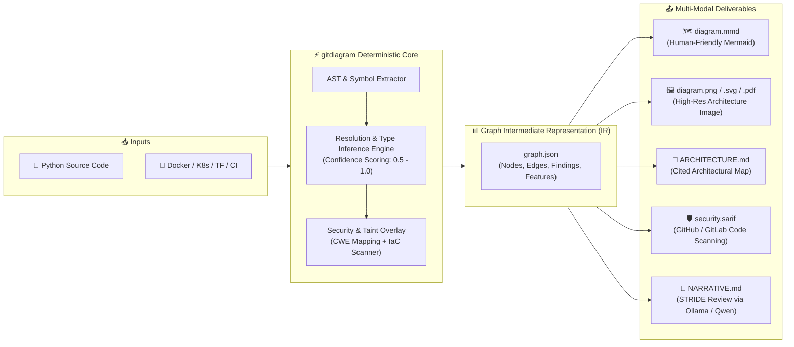

<div align="center">

# ⚡ gitdiagram

### *Small but Gold* — Deterministic Architecture, Relationship, and Security Intelligence for Python Repositories.

[](https://python.org)
[](pyproject.toml)
[](tests/)
[](Dockerfile)
[](LICENSE)
[](#-100-cross-platform-matrix)

<p align="center">
  <b>Transform complex Python codebases into human-friendly architecture diagrams, high-res images, security threat models, and AI-powered architectural reviews.</b><br>
  <i>100% offline-first. Zero external Python packages. Fully deterministic. Cites exact <code>path:line</code> for every finding.</i>
</p>

---

[Key Highlights](#-key-highlights) •
[Architecture Pipeline](#-how-it-works) •
[Quick Start](#-quick-start) •
[Containerized Run](#-containerized-execution-docker--podman) •
[Visual Diagrams & Images](#-visual-diagrams--image-generation) •
[Security & IaC SAST](#-security--iac-static-analysis) •
[AI Architectural Reviews](#-ai-architectural-reviews-ollama--qwen) •
[Cross-Platform Matrix](#-100-cross-platform-matrix) •
[CLI Reference](#-cli-reference)

---

</div>

## 🌟 Key Highlights

- **Pure Python Standard Library (`zero dependencies`)**: Runs instantly without downloading hundreds of megabytes of third-party wheels. Zero supply chain attack surface.
- **Human-Friendly Visual Architecture Diagrams**: Generates modern Mermaid diagrams organized into logical functional tiers with developer-friendly icons, clean layouts, and clickable source code links.
- **Multi-Format Image Rendering**: Export directly to **PNG**, **SVG**, or **PDF**. Uses pre-bundled offline Mermaid CLI (`mmdc`) + headless Chromium or zero-dependency HTTP fallbacks (Kroki, mermaid.ink).
- **Security & IaC SAST Overlay**: Discovers entrypoints (FastAPI, Flask, Django, Click), traces taint dataflows to dangerous sinks (command execution, SQL injection, unsafe deserialization), catches hardcoded secrets, and audits Dockerfile, Kubernetes, Terraform, and GitHub Actions configurations.
- **SARIF Code-Scanning Export**: Generates industry-standard `security.sarif` for seamless integration into GitHub Advanced Security, GitLab SAST, or DefectDojo.
- **AI Architectural & Threat Modeling Reviews**: Integrates with local/containerized **Ollama (Qwen, LLaMA, DeepSeek)** or OpenAI endpoints. The LLM receives the deterministic graph and produces evidence-grounded reviews citing exact `path:line` with zero hallucinations.
- **4 Specialized Review Profiles**: Executive Comprehensive Review, Formal STRIDE Threat Model, Developer Remediation Playbook, or OWASP/CIS Compliance Audit.
- **Hardened Multi-Stage Container**: Runs securely as an unprivileged non-root user (`gitdiagram`, UID `10001`), compatible with Docker, Docker Compose, and rootless Podman on SELinux.
- **100% Deterministic & CI-Ready**: Same codebase produces byte-for-byte identical graphs. Exit codes signal analysis success (`0`), errors (`1`), or security threshold violations (`2`).

---

## 🏗️ How It Works



---

## 🚀 Quick Start

### 1. Instant Run (No Installation Required)

Because `gitdiagram` requires **only the Python standard library**, you can run it immediately on any machine with Python 3.10+:

```bash
# Analyze current repository:
python gitdiagram.py --dir="."

# Analyze and generate an architecture image (.png):
python gitdiagram.py --dir="." --image

# Run a security scan with CI gate threshold:
python gitdiagram.py --dir="." --fail-on high
```

Default outputs are written directly to `<repo>/.gitdiagram/`:
- `graph.json` — Complete graph schema (nodes, edges, confidence, features, findings).
- `ARCHITECTURE.md` — Cited architecture breakdown and entrypoint catalog.
- `diagram.mmd` — Human-friendly visual Mermaid flowchart.
- `diagram.png` — Rendered architecture diagram image (when `--image` is specified).

---

### 2. Native CLI Installation

```bash
# Clone the repository:
git clone https://github.com/your-org/gitdiagram.git
cd gitdiagram

# (Optional) Create a virtual environment:
python3 -m venv .venv
source .venv/bin/activate  # On Windows: .venv\Scripts\Activate.ps1

# Install in editable mode:
pip install -e .

# Run anywhere:
gitdiagram --dir /path/to/project --image svg
```

---

## 🐳 Containerized Execution (Docker & Podman)

`gitdiagram` provides an enterprise-ready, multi-stage Docker image built on `python:3.12-slim` and `node:20-slim`. It executes as an unprivileged non-root user (`uid=10001`) and comes pre-bundled with `@mermaid-js/mermaid-cli` and Chromium for **100% offline diagram image rendering**.

### Standalone Docker Execution

Mount your target project to `/repo` (the container's default `WORKDIR`):

```bash
# Linux / macOS:
docker run --rm -v "$(pwd):/repo" gitdiagram:latest --image

# Windows PowerShell:
docker run --rm -v "${PWD}:/repo" gitdiagram:latest --image

# Windows Command Prompt (CMD):
docker run --rm -v "%cd%:/repo" gitdiagram:latest --image

# RHEL / Fedora / CentOS (SELinux mode with :z flag):
docker run --rm -v "$(pwd):/repo:z" gitdiagram:latest --image
```

> [!TIP]
> **Windows Git Bash Users**: Git Bash on Windows automatically translates POSIX paths (e.g. `/repo` to `C:/Program Files/Git/repo`). `gitdiagram` includes built-in MSYS auto-recovery. You can also simply omit `--dir` entirely (the container defaults to the mounted repository) or use double slashes `--dir //repo`.

---

### Multi-Service Docker Compose with Local Ollama (Qwen)

Run `gitdiagram` alongside a companion Ollama container over an isolated internal bridge network:

```bash
# 1. Start Ollama:
docker compose up -d ollama

# 2. Pull Qwen (or any Ollama model):
docker compose exec ollama ollama pull qwen2.5-coder

# 3. Run gitdiagram with AI-powered architectural review:
docker compose run --rm gitdiagram --ollama qwen2.5-coder --llm-template comprehensive --image
```

---

## 🗺️ Visual Diagrams & Image Generation

### Human-Friendly Architecture Views

Traditional AST visualizers generate chaotic "spaghetti graphs" containing thousands of trivial helper symbols. `gitdiagram` defaults to `--diagram-detail architecture`, which groups your codebase into clean functional clusters:

- **Tiered Subgraphs**: Entrypoints & Web APIs → Core Domain Services & Modules → Data Models & Infrastructure.
- **Visual Emojis & Badges**: `🌐 GET /api/v1/users`, `⚙️ UserService`, `📦 UserModel`, `🛡️ CWE-89`.
- **Modern Theme**: Professional color palette inspired by Tailwind CSS (`--diagram-theme modern` or `classic`).
- **Directional Control**: Choose horizontal `--diagram-direction LR` (default) or vertical `TB`.
- **Interactive Source Links**: Supply `--link-base https://github.com/org/repo/blob/main` to make diagram nodes clickable directly to GitHub/GitLab lines.

### Multi-Format Diagram Images

Generate publication-ready architecture diagrams in **PNG**, **SVG**, or **PDF**:

```bash
# Default PNG output (diagram.png):
gitdiagram --image

# Crisp vector SVG output (diagram.svg):
gitdiagram --image svg

# High-resolution PDF document (diagram.pdf):
gitdiagram --image pdf

# Export all diagram formats simultaneously:
gitdiagram --format json,md,mermaid,png,svg,pdf
```

#### Rendering Providers (`--image-provider`):
1. **`auto` (default)**: Uses local offline Mermaid CLI (`mmdc`) if available. Otherwise, falls back seamlessly to open-source Kroki / mermaid.ink HTTP endpoints via standard library `urllib` (zero pip packages required).
2. **`local`**: Offline rendering via bundled Mermaid CLI (`mmdc`) + headless Chromium.
3. **`kroki`**: Uses public `https://kroki.io` or your private on-premise Kroki container (`--image-endpoint`).
4. **`mermaid.ink`**: Uses the public mermaid.ink image service.

---

## 🛡️ Security & IaC Static Analysis

`gitdiagram` performs static security analysis across Python application code and infrastructure files:

### Application Security Rules (SAST)

| Category | CWE | Patterns Detected | Severity |
| :--- | :--- | :--- | :--- |
| **Command Injection** | CWE-78 | `subprocess` with `shell=True`, `os.system`, `os.popen`, `eval`, `exec` with tainted variables | Critical / High |
| **SQL Injection** | CWE-89 | Raw SQL string interpolation, f-strings, `%` formatting in DB executions | High |
| **Unsafe Deserialization** | CWE-502 | `pickle.loads`, `yaml.load` without `SafeLoader` | Critical / High |
| **Path Traversal** | CWE-22 | Unsanitized file path joins with user inputs | High |
| **Weak Cryptography** | CWE-327 | Use of `MD5`, `SHA1` for security contexts, hardcoded AES ECB mode | Medium |
| **Hardcoded Secrets** | CWE-798 | Embedded API keys, AWS tokens, private keys, populated `.env` files | High / Medium |

### Infrastructure-as-Code (IaC) Rules

- **Dockerfile**: Root user execution (`USER root` or missing non-root user), unpinned base tags (`:latest`), exposed privileged ports.
- **Kubernetes**: Missing `runAsNonRoot`, `privileged: true`, dangerous capabilities (`SYS_ADMIN`), missing resource limits.
- **Terraform**: S3 buckets with public read/write ACLs, unrestricted security group ingress (`0.0.0.0/0`).
- **GitHub Actions**: Workflows using `pull_request_target` with explicit checkouts, untrusted script execution.

### CI/CD Quality Gate & SARIF Integration

Fail your CI build if security findings exceed your threshold:

```bash
# Exit code 2 if any critical or high vulnerability is found:
gitdiagram --fail-on high --format json,md,sarif
```

Upload `security.sarif` directly to GitHub Code Scanning:

```yaml
- name: Run gitdiagram Security Scan
  run: python gitdiagram.py --dir . --fail-on high --format sarif

- name: Upload SARIF to GitHub Security Dashboard
  uses: github/codeql-action/upload-sarif@v3
  if: always()
  with:
    sarif_file: .gitdiagram/security.sarif
```

---

## 🤖 AI Architectural Reviews (Ollama & Qwen)

Turn raw graphs into executive-ready security architecture reviews using **local offline models** (Qwen, LLaMA, DeepSeek) or OpenAI:

```bash
# Run with local Ollama using Qwen:
python gitdiagram.py --ollama qwen2.5-coder

# Choose a specialized architectural review template:
python gitdiagram.py --ollama qwen2.5-coder --llm-template comprehensive
```

### 4 Specialized Review Profiles (`--llm-template`):

1. **`comprehensive` (default)**:
   - 1. Executive Summary & Security Posture Scorecard.
   - 2. Attack Surface Catalog & Ingress Points (`path:line`).
   - 3. Trust Boundaries & Component Data Flow Analysis.
   - 4. Deep-Dive Threat Modeling (STRIDE / CWE).
   - 5. Infrastructure, Supply Chain & IaC Posture.
   - 6. Prioritized Remediation Roadmap (P0 / P1 / P2).

2. **`threat-model`**:
   - Formal STRIDE threat matrix (Spoofing, Tampering, Repudiation, Info Disclosure, DoS, Elevation of Privilege).
   - Component trust boundary crossings and attack trees.

3. **`remediation`**:
   - Developer-centric vulnerability-by-vulnerability fix guide.
   - Exact vulnerable patterns vs. secure drop-in code replacements.

4. **`compliance`**:
   - Formal audit mapping against **OWASP Top 10 (2021)** and **CIS Software Benchmarks**.

> [!NOTE]
> **Strict Anti-Hallucination Guardrails**: The LLM prompt enforces that every finding, component, and flow must cite an exact `path:line` present in the deterministic graph. The model cannot invent phantom files or hallucinate non-existent vulnerabilities.

---

## 🌐 100% Cross-Platform Matrix

`gitdiagram` runs seamlessly across all major operating systems, shells, and enterprise server environments:

| Operating System | Environments Supported | Primary Commands |
| :--- | :--- | :--- |
| **macOS** | Apple Silicon (`arm64`), Intel (`x86_64`) | `docker run -v "${PWD}:/repo" gitdiagram:latest --image`<br>`python gitdiagram.py --image` |
| **Ubuntu / Debian** | Ubuntu 20.04+, Debian 11+ (`x86_64`, `arm64`) | `docker run -v "$(pwd):/repo" gitdiagram:latest --image`<br>`python3 gitdiagram.py --image` |
| **RHEL / Rocky / Alma** | RHEL 8/9, CentOS, Fedora, Podman, SELinux | `podman run -v "$(pwd):/repo:z" gitdiagram:latest --image`<br>`docker run -v "$(pwd):/repo:z" gitdiagram:latest --image` |
| **Windows** | PowerShell 5.1/7+, CMD, Git Bash, WSL2 | `docker run -v "${PWD}:/repo" gitdiagram:latest --image`<br>`python gitdiagram.py --image` |

---

## 📖 CLI Reference

```text
usage: gitdiagram [-h] [--dir DIR] [--out OUT] [--format FORMAT]
                  [--include GLOB] [--exclude GLOB]
                  [--min-confidence MIN_CONFIDENCE] [--max-nodes MAX_NODES]
                  [--security] [--no-security] [--link-base LINK_BASE]
                  [--image [FORMAT]] [--image-format {png,svg,pdf}]
                  [--image-provider {auto,local,kroki,mermaid.ink}]
                  [--image-endpoint IMAGE_ENDPOINT] [--offline]
                  [--diagram-detail {architecture,full}]
                  [--diagram-direction {LR,TB}]
                  [--diagram-theme {modern,classic}]
                  [--ollama [MODEL]] [--llm] [--llm-model LLM_MODEL]
                  [--llm-base-url LLM_BASE_URL] [--llm-api-key LLM_API_KEY]
                  [--llm-template {comprehensive,threat-model,remediation,compliance}]
                  [--llm-timeout LLM_TIMEOUT] [--llm-max-tokens LLM_MAX_TOKENS]
                  [--fail-on {critical,high,medium,low,info,none}]
                  [--quiet] [--version]
```

### Options Breakdown

| Flag | Default | Description |
| :--- | :--- | :--- |
| `--dir DIR` | `.` | Target repository directory to inspect |
| `--out OUT` | `<dir>/.gitdiagram` | Output directory for all generated artifacts |
| `--format FORMAT` | `json,md,mermaid` | Comma-separated outputs: `json`, `md`, `mermaid`, `sarif`, `png`, `svg`, `pdf` |
| `--image [FORMAT]` | `png` | Render visual diagram to image (`png`, `svg`, `pdf`) |
| `--image-provider` | `auto` | Image renderer: `auto`, `local` (`mmdc`), `kroki`, `mermaid.ink` |
| `--offline` | `false` | Enforce strictly offline execution; forbids external HTTP calls |
| `--diagram-detail` | `architecture` | Visual detail level: `architecture` (clean tiers) or `full` (every symbol) |
| `--max-diagram-nodes` | `150` | Max components displayed in architecture diagram; 0 for unlimited |
| `--diagram-direction`| `LR` | Diagram orientation: `LR` (horizontal) or `TB` (top-to-bottom) |
| `--diagram-theme` | `modern` | Visual theme palette: `modern` (Tailwind) or `classic` |
| `--link-base URL` | `None` | Prefix for clickable source links (e.g. `https://github.com/org/repo/blob/main`) |
| `--security / --no-security` | enabled | Toggle SAST security rules and IaC configuration checks |
| `--fail-on SEVERITY` | `none` | Return exit code `2` if findings meet or exceed severity threshold |
| `--ollama [MODEL]` | `qwen2.5-coder` | Generate AI review using local Ollama (`qwen2.5-coder`, `qwen2.5:7b`, etc.) |
| `--llm-template` | `comprehensive` | Prompt profile: `comprehensive`, `threat-model`, `remediation`, `compliance` |
| `--llm-timeout` | `300s` (Ollama) | Network timeout in seconds for LLM generation |
| `--llm-max-tokens` | `1500` | Maximum completion tokens generated by the model |
| `--quiet` | `false` | Suppress console summary output |
| `--version` | — | Display program version (`gitdiagram 0.1.0`) |

### Exit Codes

- `0`: Success (all outputs generated, no security thresholds violated).
- `1`: Error (invalid arguments, AST analysis failure, or unrecoverable error).
- `2`: Security Threshold Breached (vulnerabilities found at or above `--fail-on` severity).

---

## 🧪 Comprehensive Test Suite

`gitdiagram` includes a test suite covering AST discovery, call resolution, security heuristics, image renderers, and deterministic CLI behaviors:

```bash
# Run all unit tests:
python -m unittest discover -s tests -v

# Or simply:
python -m unittest
```

```text
Ran 89 tests in 0.958s
OK
```

---

## ⚖️ License

Distributed under the **MIT License**. See [`LICENSE`](LICENSE) for full details.
